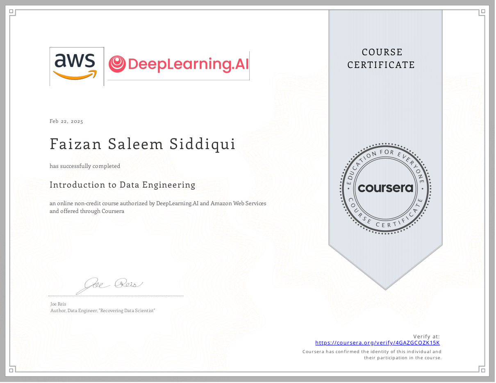

# Data Engineering & Data Analysis Projects


[](LICENSE)

Hands-on data engineering on AWS (batch and streaming ingestion, orchestration, infrastructure as
code, data quality and monitoring), plus exploratory data analysis and visualisation projects in Python.

## 🎓 Certification

<p align="center">
  <a href="certificates/Introduction-to-Data-Engineering-DeepLearningAI-AWS.pdf">
    
  </a>
</p>

**Introduction to Data Engineering**, DeepLearning.AI & Amazon Web Services (Coursera), February 2025
· [Verify credential](https://coursera.org/verify/4GAZGCOZK15K) · [PDF](certificates/Introduction-to-Data-Engineering-DeepLearningAI-AWS.pdf)

## ☁️ AWS Data Engineering Projects

Hands-on labs from the DeepLearning.AI & AWS Data Engineering program, each completed and documented
as a standalone project in [`aws-data-engineering/`](aws-data-engineering).

| Project | What it does | Stack |
|---|---|---|
| [Batch ingestion from the Spotify API](aws-data-engineering/batch-ingestion-spotify-api) | Paginated REST extraction with OAuth2 token refresh, saved as timestamped JSON | Python, `requests`, Spotipy |
| [Streaming ingestion: Kinesis to S3](aws-data-engineering/streaming-ingestion-kinesis-s3) | Real-time order stream routed by region into two S3 buckets via Firehose | Kinesis Data Streams, Firehose, S3, boto3 |
| [Airflow orchestration best practices](aws-data-engineering/airflow-orchestration-best-practices) | DAG design with task groups, XCom and idempotent tasks | Apache Airflow, MySQL (RDS) |
| [Airflow user-sessions pipeline](aws-data-engineering/airflow-user-sessions-pipeline) | End-to-end ETL DAG for a music platform's user session data | Apache Airflow, S3, Python |
| [Dynamic DAGs with data quality gates](aws-data-engineering/airflow-dynamic-dags-data-quality) | Template-generated per-vendor ML pipelines: validate, train, branch, deploy | Airflow, Jinja, Great Expectations, SciPy |
| [Data quality with Great Expectations](aws-data-engineering/data-quality-great-expectations) | Expectation suites, checkpoints and data docs for automated validation | Great Expectations, S3 |
| [DataOps infrastructure with Terraform](aws-data-engineering/dataops-infrastructure-terraform) | Modular IaC for a bastion host, RDS database and networking | Terraform, EC2, RDS, VPC, IAM |
| [Data monitoring with CloudWatch](aws-data-engineering/data-monitoring-cloudwatch) | Database metrics, dashboards, alarms and SNS email alerts as code | CloudWatch, SNS, Terraform |
| [Amazon DynamoDB operations](aws-data-engineering/dynamodb-nosql-operations) | CRUD, batch writes, queries, scans and transactions | DynamoDB, boto3 |
| [Amazon S3 object storage](aws-data-engineering/s3-object-storage) | Buckets, objects, structured/semi-structured/unstructured data | S3, boto3 |
| [Relational database with SQL](aws-data-engineering/relational-database-sql) | Joins, aggregations and analytical queries | SQL, MySQL |
| [Troubleshooting AWS connectivity](aws-data-engineering/troubleshooting-aws-connectivity) | Diagnosing and fixing EC2 to RDS access (security groups, IAM, networking) | RDS, EC2, VPC, IAM |

## 📊 Data Analysis & Visualisation

| Project | Highlights |
|---|---|
| [California housing prices](data-analysis/california-housing-prices) | Missing-value handling, distributions, outliers, correlation analysis for price modelling |
| [Heart disease EDA](data-analysis/heart-disease-eda) | Categorical vs continuous feature analysis, risk-factor relationships |
| [Titanic data visualisation](data-analysis/titanic-data-visualization) | A tour of Seaborn and Plotly chart types, explained step by step |

## Repository layout
```
aws-data-engineering/   12 cloud data engineering projects (code, notebooks, IaC, docs)
data-analysis/          3 exploratory data analysis notebooks with datasets
certificates/           course certificate (PDF + image)
```

## Running the projects
- **Data analysis:** `pip install -r requirements.txt` inside a project folder, then open the notebook.
- **AWS projects:** need your own AWS account. Credentials are read from environment variables or
  `env` files that are never committed (each project ships an `env.example` where needed).

---
## 👤 About the Author

**Faizan Saleem Siddiqui**, Embedded Firmware Engineer | Research Scholar

Electronics engineer with 2+ years of experience in embedded systems and firmware development.
I build production firmware for **BLE wearables and biosignal devices** on Nordic nRF52 (Zephyr / nRF
Connect SDK), including **secure OTA updates (MCUboot, signed images)**, **low-power battery
management** and **true-wireless Bluetooth audio**. My background also covers STM32 and ESP32 with
FreeRTOS, real-time data acquisition, digital signal processing, industrial IoT, and Python tooling
for data, automation and machine learning.

- 🎓 MS Electronics, Quaid-i-Azam University, Islamabad (BS Electronics: 1st position, merit scholar)
- 🧑‍🏫 Former Visiting Faculty, Embedded Systems, and Research Assistant, Autonomous Vehicles (COMSIP Lab)
- 🌍 Open to embedded / firmware engineering opportunities worldwide

[](https://www.linkedin.com/in/faizan-saleem-siddiqui-4411bb247/)
[](https://github.com/FaizanSSDQ)
[](mailto:faizansaleemsdq@gmail.com)

Licensed under the [MIT License](LICENSE). Lab starter material © DeepLearning.AI.
